<div align="center">

# 🔍 edge_research

**From MQL5 indicator exports to statistically tested trade ideas — repeatably.**

Raw CSV → candidate conditions → forward tests → robustness checks → ranked edges → MQL5 EA stubs


</div>

---

## 📑 Contents

- [What it does](#-what-it-does)
- [Installation](#-installation)
- [Quick start](#-quick-start)
- [Cheat sheet](#-cheat-sheet)
- [MQL5 data exporters](#-mql5-data-exporters)
- [Economic calendar and news features](#-economic-calendar-and-news-features)
- [Configuration](#-configuration)
- [Walk-forward mode](#-walk-forward-mode)
- [Running several runs at once](#-running-several-runs-at-once)
- [Ranker](#-ranker)
- [Output layout](#-output-layout)
- [How the pipeline works](#-how-the-pipeline-works)
- [Project structure](#-project-structure)
- [Development](#-development-and-testing)
- [Notes](#-notes)

---

## ✨ What it does

```mermaid
flowchart LR
    A[MQL5 CSV export] --> B[Ingest + Parquet]
    B --> C[Known-at tagging]
    C --> D[Condition generation]
    D --> E[Frequency filter]
    E --> F[Forward profiling]
    F --> G[Significance + FDR]
    G --> H[Robustness validation]
    H --> I[Reports + MQL5 EA stubs]
    I --> J[Ranker]
```



| Stage | What happens |
|---|---|
| **1. Ingest** | Load and validate MQL5 CSV data, store it as Parquet for reuse |
| **2. Known-at** | Tag indicator availability so delayed indicators are handled correctly |
| **3. Conditions** | Generate candidates (RSI oversold, MA relationships, calendar and volatility rules, ...) |
| **4. Frequency** | Drop conditions that are too rare to be meaningful |
| **5. Forward profile** | Measure forward-looking probabilities over multiple horizons |
| **6. Significance** | Statistical tests with false-discovery-rate correction |
| **7. Robustness** | Walk-forward, regime stress, parameter sensitivity, cost model |
| **8. Reports** | YAML reports and a markdown summary |
| **9. Code generation** | Compilable MQL5 Expert Advisor source files |
| **10. Ranker** *(walk-forward)* | Rank combinations per window and per timeframe, remove near-duplicates, require a plateau |

---

## 🛠 Installation

```bash
python -m venv .venv
source .venv/bin/activate
python -m pip install --upgrade pip
python -m pip install -e ".[dev]"
pip install tabulate pyarrow     # also required; pyproject.toml has not been updated yet
```

Requires Python 3.9+. Dependencies are defined in [pyproject.toml](pyproject.toml).

---

## 🚀 Quick start

A sample export is included: [data/raw_csv/XAUUSD_D1_export_20100101.csv](data/raw_csv/XAUUSD_D1_export_20100101.csv).

**Single run** (one fixed block of history):

```bash
python scripts/run_pipeline.py \
  data/raw_csv/XAUUSD_H4_export_20100101.csv \
  --symbol XAUUSD \
  --timeframe H4 \
  --config-dir config/XAUUSD/H4 \
  --output-dir output
```

**Short history** (a few months up to ~1 year): use the matching profile under `config/SHORT_DATA/`, everything else stays the same:

```bash
python scripts/run_pipeline.py \
  data/raw_csv/XAUUSD_M1_1y.csv \
  --symbol XAUUSD --timeframe M1 \
  --config-dir config/SHORT_DATA/XAUUSD/M1 \
  --output-dir output
```

**Walk-forward run** (recommended for the full multi-year export):

```bash
python scripts/run_walkforward_pipeline.py \
  data/raw_csv/XAUUSD/XAUUSD_H1.csv \
  --symbol XAUUSD --timeframe H1 \
  --config-dir config/WALKFORWARD/XAUUSD/H1 \
  --output-dir output_walkforward
```

A run produces a Parquet `storage/` folder, YAML edge reports in `reports/`, generated EAs in `generated_ea/`, and `EDGES_SUMMARY.md`. Walk-forward runs also produce `WALKFORWARD_SUMMARY.md` and the ranker files (see [Output layout](#-output-layout)).

---

## 🧾 Cheat sheet

| I want to... | Command |
|---|---|
| Run one fixed block of history | `python scripts/run_pipeline.py <csv> --symbol S --timeframe TF --config-dir config/S/TF --output-dir output` |
| Run walk-forward | `python scripts/run_walkforward_pipeline.py <csv> --symbol S --timeframe TF --config-dir config/WALKFORWARD/S/TF --output-dir output_walkforward` |
| Run several in parallel | Open another terminal and run the same command (every run gets its own folder) |
| Name a run folder myself | add `--run-name my_label` |
| Write into `--output-dir` directly (old behaviour) | add `--flat-output` |
| List runs and their status | `python scripts/list_runs.py output_walkforward` |
| Use strict-filter ranking (default) | `--mode filter` |
| Just sort and take the top 5 / 10 | `--mode sort --sort-top-n 5` |
| Write both ranker files | `--mode both` |
| Skip the ranker | `--no-ranker` |
| Re-rank an old run | `python scripts/run_ranker.py output_walkforward/<run folder> --symbol S --timeframe TF --mode sort` |
| Add calendar features | `--calendar-csv data/economic_calendar.csv` |
| Stop before the PC freezes | `--min-free-gb 2` (default) / `--max-rss-gb N` |

---

## 📡 MQL5 data exporters

The `mql5/` folder holds the programs that produce the input files.

| Program | Type | Output | Used by |
|---|---|---|---|
| `dataExporter.mq5` (v1.02) | EA, Strategy Tester | `<SYMBOL>_<TF>_export_<date>.csv`: OHLCV, ~100 standard indicators, custom-indicator columns, `news_*` columns | `csv_path` argument |
| `economicCalendar.mq5` | Script, **live chart** | `economic_calendar.csv` (Common\Files) | `--calendar-csv` (optional) |
| `volRegime.mq5`, `priceStructure.mq5` | Custom indicators | compiled to `VolRegime_ATR.ex5` / `PriceStructure.ex5` | read by `dataExporter.mq5` via `iCustom()` |

> 💡 **Tester model for the export:** use **Open prices only**. The export reads values once per bar, so a heavier model only costs time.

`dataExporter.mq5` needs the compiled `VolRegime_ATR.ex5` and `PriceStructure.ex5` to be found by the tester (`#property tester_indicator`). If `iCustom()` fails the exporter writes `NaN`, and the loader logs a warning naming the indicator whose columns are entirely NaN. `priceStructure.mq5` has an `InpSessionTF` input (default: chart timeframe) that sets the timeframe used for session highs/lows.

**Custom-indicator columns**

| Group | Columns |
|---|---|
| Volatility regime | `volregime_atr_pctl` (0-100), `volregime_atr_ratio` (ATR / SMA(ATR)), `volregime_regime` (0 low / 1 mid / 2 high) |
| Price structure | `ps_dist_pdh_atr`, `ps_dist_pdl_atr`, `ps_dist_sess_h_atr`, `ps_dist_sess_l_atr`, `ps_dist_round_up_atr`, `ps_dist_round_dn_atr` — `(level - price) / ATR`, positive = level above price |
| Gap | `ps_gap_atr` (signed daily gap in ATR), `ps_gap_fill_pct` (0-100) |

They are picked up automatically: the condition generator creates atoms for every one of these columns present in the CSV (thresholds in the `volregime_*` and `ps_*` keys of `pipeline_config.yaml`). Exports from the older exporter (no custom columns) still load. The time column is parsed in the exporter's `YYYYMMDD HH:MM` format.

> ⚠️ **Known limitation of the PriceStructure export.** `priceStructure.mq5` writes its buffers only for the last bar (shift 0), while `dataExporter.mq5` reads shift 1 at each new bar. In a tester export the `ps_*` values therefore most likely reflect the state at the bar's first tick (price = the bar's open), not its close. That is not look-ahead, but it differs from the other columns and from what an EA would read live at shift 0. Verify before trusting `ps_*` edges.

---

## 📅 Economic calendar and news features

Two ways to bring economic events in:

### `news_*` columns — embedded in the export (exporter v1.02)

Attach `dataExporter.mq5` to a **live chart** once (it writes `economic_calendar.csv` to Common\Files), then run it in the Strategy Tester. The tester export gets `news_min_to_next`, `news_next_importance`, `news_min_since_last`, `news_last_importance`, `news_last_surprise`, `news_in_window`, `news_count_next_24h`. The live-chart CSV has the same format as the stand-alone script, so it also works with `--calendar-csv`.

The loader repairs two issues in these columns before anything else sees them (`loader.sanitize_news_columns`):

1. **Look-ahead at the bar close.** The EA counts an event stamped exactly at the bar close as already released, so `news_last_surprise` holds a release's result on the very row where the decision is taken, before the market reacts. NFP/CPI/FOMC often sit exactly on a bar boundary. Those rows are rewritten: the event becomes the *next* event and the last-event fields become NaN.
2. **Calendar coverage.** Bars before the first or after the last calendar event are set to NaN instead of looking like "far from news".

Atoms are generated for `news_*` (surprise: sign only, because its raw units differ per event), and edges using them are flagged like `cal_*` ones.

Remaining caveats: the exported surprise is not oriented by impact (higher unemployment is bad news), and `news_*_importance` is constant when only HIGH events were exported (no atoms are created for a constant column).

### `cal_*` columns — computed in Python (`--calendar-csv`)

The better-normalised alternative: z-scored surprise and symbol-oriented impact.

```bash
python scripts/run_pipeline.py data/raw_csv/XAUUSD/XAUUSD_M30_export_20100101.csv \
  --symbol XAUUSD --timeframe M30 \
  --config-dir config/XAUUSD/M30 --output-dir output \
  --calendar-csv data/economic_calendar.csv
# same flag for scripts/run_walkforward_pipeline.py
```

`edge_research/ingestion/economic_calendar.py` joins the calendar to every bar (both files are in broker server time, no conversion) and adds float32 columns that are mined like any other indicator:

| Column | Meaning |
|---|---|
| `cal_min_to_next_high` / `cal_min_since_last_high` | Minutes to the next scheduled / since the last released event of importance >= `calendar_importance_high` (capped at `calendar_max_minutes`) |
| `cal_high_in_bar` / `cal_high_next_bar` | 1 if such an event was released inside this bar / is scheduled inside the next bar |
| `cal_*_medplus` | The same four for importance >= `calendar_importance_medplus` |
| `cal_last_impact_sym` | +1 / -1 / 0: MT5 impact flag of the last high-impact release, re-oriented to the symbol (positive USD impact = -1 for XAUUSD); 0 after `calendar_impact_max_age_min` |
| `cal_last_surprise_absz` | abs(actual - forecast) in std units of that event's own past surprises (expanding, previous releases only) |

- Only currencies that matter for the symbol are used (XAUUSD → USD, EURUSD → EUR + USD; override with `calendar_currencies`). Holidays are dropped.
- Bars outside the calendar file's time range get NaN (never "no news"), so export the calendar from the start of your price history.
- No look-ahead: features use only events strictly before the bar close, plus the public schedule.

> ⚠️ **Calendar edges cannot be cross-checked in MT5.** The calendar API does not work in the Strategy Tester (error 4014). Edges whose condition reads a `cal_*` or `news_*` column are therefore flagged `uses_calendar` in `STRATEGY_GATE_RESULTS.csv`, the summary table, the markdown report, the report YAML metadata and the generated stub comment. The same applies to `uses_custom_indicators` (an EA must read `volregime_*` / `ps_*` through `iCustom()`). In walk-forward mode the flags are in each window's `TEST_PERIOD_RESULTS.csv`, and the ranker shows them as `CAL` / `CUSTOM`.

---

## ⚙️ Configuration

| File / folder | Purpose |
|---|---|
| [config/pipeline_config.yaml](config/pipeline_config.yaml) | General thresholds, horizons, significance and validation parameters |
| [config/known_at_delay.yaml](config/known_at_delay.yaml) | Known-at delay settings for indicator tagging |
| `config/<SYMBOL>/<TF>/` | Long-history profile (full multi-year export), single runs |
| `config/SHORT_DATA/<SYMBOL>/<TF>/` | A few months up to ~1 year of data. Walk-forward window sizes and minimum-occurrence thresholds are the only differences |
| `config/WALKFORWARD/<SYMBOL>/<TF>/` | Walk-forward mode on the full multi-year export (see [why it is separate](#-walk-forward-mode)) |
| `config/_legacy/` | Archived older layouts, see `config/_legacy/README.md` |

Each profile has its own `pipeline_config.yaml` and `known_at_delay.yaml`. Edit them to change behaviour without touching code. See the comment header in any `config/SHORT_DATA/.../pipeline_config.yaml` for the bar-count assumption and how to rescale it.

---

## 🔁 Walk-forward mode

A single run discovers conditions from, and validates them against, one fixed block of history. `scripts/run_walkforward_pipeline.py` runs the **entire** pipeline repeatedly on a rolling window — "Rolling Out-of-Sample":

```
train ----> test
      train ----> test
            train ----> test
                  train ----> test
```

**Per window:**

1. Run the whole normal pipeline (condition generation through the Phase 7e strategy gate) on the **train** slice only.
2. Keep only the passed conditions that also sit on a **plateau**: their `parameter_sensitivity` score (a ±15% threshold shift shouldn't wreck the result) must clear `meta_wf_plateau_min_sensitivity`. A condition that only works at one hyper-specific value is noise, not an edge.
3. Re-evaluate each survivor's direction and holding period — frozen exactly as chosen on train, no re-optimising — on the **test** slice it was never selected with. Keep only what is still net profitable.
4. Record whatever is accepted (zero conditions is a valid result, not a failure) and slide the window forward.

Different windows may accept completely different conditions, or none. That is intentional: the point is to test whether an edge is time-local instead of assuming one combination of indicators works forever.

### Two windowing modes

The mode depends on which keys the config-dir's `pipeline_config.yaml` contains:

| Config tier | Windowing | Outer window | Use for |
|---|---|---|---|
| `config/SHORT_DATA/<SYMBOL>/<TF>/` | Bar-count (`meta_wf_train_bars` / `meta_wf_test_bars` / `meta_wf_step_bars`) | ~3 months | A CSV covering a few months to ~1 year, too short for one calendar year |
| `config/WALKFORWARD/<SYMBOL>/<TF>/` | **Calendar-year** (`meta_wf_runs`) | 3 years train / 1 year test, rolled 1 year at a time | The full multi-year export |

<details>
<summary><b>Calendar mode (<code>meta_wf_runs</code>) in detail</b></summary>

Calendar mode anchors every window to January 1st instead of wherever a fixed bar count lands. A fixed bar count starts and ends at a different real date depending on how many rows exist in each stretch (weekends, holidays and session gaps shift it), so "train on roughly 3 years" could silently mean 2010-04-17..2013-06-02 in one run and something else in another. A period you already know is good can end up split across two windows or diluted just because a bar-count boundary fell in the middle. Calendar mode fixes both.

`meta_wf_runs` is a **list**; each entry is an independent walk-forward sequence:

```yaml
meta_wf_runs:
  - start_year: 2010
    train_years: 3
    test_years: 1
    step_years: 1
  - start_year: 2011
    train_years: 3
    test_years: 1
    step_years: 1
```

The first entry trains on exactly 2010-01-01..2013-01-01, tests on 2013-01-01..2014-01-01, then rolls the train start forward by `step_years` and repeats while the data lasts. The second entry is a **separate, independent** sequence anchored a year later, not a continuation. Add or remove entries to run more or fewer of them; each one reruns the whole pipeline on every one of its windows, so more entries means more runtime. `step_years` need not equal `test_years`: a smaller step gives overlapping test periods, a larger one skips ahead.

If the data does not end exactly on a year boundary (normal), the final window is still produced but marked `truncated` in `WALKFORWARD_SUMMARY.md`, with both the nominal and the actual date range. Check that flag before trusting a truncated window's test result like a full one.

**Bar-count mode** is what `config/SHORT_DATA/` still uses, unchanged. Calendar-year windows make no sense on a dataset that does not span a full year.

</details>

### Usage

Identical either way; the config-dir decides the mode:

```bash
python scripts/run_walkforward_pipeline.py \
  data/raw_csv/XAUUSD/XAUUSD_M5.csv \
  --symbol XAUUSD \
  --timeframe M5 \
  --config-dir config/WALKFORWARD/XAUUSD/M5 \
  --output-dir output_walkforward
```

More examples (change symbol, timeframe, csv and config-dir):

| Symbol / TF | CSV | Config dir |
|---|---|---|
| XAUUSD M1 | `data/raw_csv/XAUUSD/XAUUSD_M1.csv` | `config/WALKFORWARD/XAUUSD/M1` |
| XAUUSD H1 | `data/raw_csv/XAUUSD/XAUUSD_H1.csv` | `config/WALKFORWARD/XAUUSD/H1` |
| EURUSD H1 | `data/raw_csv/EURUSD_H1_export_20100101.csv` | `config/WALKFORWARD/EURUSD/H1` |
| EURUSD M5 | `data/raw_csv/EURUSD_M5_export_20100101.csv` | `config/WALKFORWARD/EURUSD/M5` |

> ❗ **Do not use `config/<SYMBOL>/<TF>/` for walk-forward mode.** That profile deliberately has no `meta_wf_*` block. Its `wf_train_bars` / `wf_test_bars` (the *inner* walk-forward check run once per window inside Phase 7) assume the entire multi-year file is the training set. Pointed at walk-forward mode, the inner check would need more bars than one outer window contains, silently produce zero inner windows, fail every condition's `robust_walk_forward` check and report "0 candidates", with no crash and nothing that looks like an error. `run_walkforward_pipeline.py` checks for exactly this (comparing `wf_train_bars + wf_test_bars` against the **observed** bar count of an actual train window) and refuses to start. If you see that error, use `config/WALKFORWARD/` or `config/SHORT_DATA/`.

<details>
<summary><b>Inner vs. outer walk-forward (why the keys are named differently)</b></summary>

`wf_train_bars` / `wf_test_bars` / `wf_step_bars` control the check run **once inside a single pipeline pass** (direction consistency, holding-bars stability; see Phase 7). `meta_wf_runs` (or, in bar-count mode, `meta_wf_train_bars` / `meta_wf_test_bars` / `meta_wf_step_bars`) control the **outer** rolling windows the whole pipeline runs on. Both matter, and they are namespaced apart (`meta_wf_*` vs `wf_*`) so changing one never silently changes the other.

If you build a profile for a different window length (e.g. `train_years: 5`), recalibrate that profile's own `wf_train_bars` / `wf_test_bars` / `wf_step_bars` / `min_occurrence` for its window size, the same way `config/SHORT_DATA/` and `config/WALKFORWARD/` were built. Do not just change `meta_wf_runs` on `config/<SYMBOL>/<TF>/` and expect it to work.

</details>

---

## 🖥 Running several runs at once

`--output-dir` is a **parent** folder. Every invocation creates its own sub-folder in it, so you can open as many terminals as you like, point them all at the same `--output-dir`, and nothing is overwritten:

```bash
python scripts/run_walkforward_pipeline.py data/raw_csv/XAUUSD/XAUUSD_H1.csv \
  --symbol XAUUSD --timeframe H1 \
  --config-dir config/WALKFORWARD/XAUUSD/H1 --output-dir output_walkforward
# → output_walkforward/20261025_143012_XAUUSD_H1_p4242/
```

| Option | Effect |
|---|---|
| `--run-name my_label` | Choose the sub-folder name yourself. Refused if the folder exists and is not empty, so an old result can never be overwritten |
| `--flat-output` | Old behaviour: write straight into `--output-dir`. Parallel runs sharing that folder **will** overwrite each other |

Every run folder contains:

- `RUN_INFO.json`: status (`running` / `completed` / `failed` / `interrupted` / `stopped_by_memory_guard`), arguments, PID, timings
- `run.log`: the log of that run only

```bash
python scripts/list_runs.py output_walkforward     # all runs and their status
```

The same applies to `scripts/run_pipeline.py`.

> ⚠️ **RAM.** Every process loads the CSV and its own DataFrame, so N parallel runs need roughly N times the memory. Heavy inputs (e.g. M1) can freeze the machine: start them one after another and watch memory use. `--min-free-gb` checks **system-wide** free RAM, so when memory runs short all running processes may stop together (status `stopped_by_memory_guard`).

---

## 🏆 Ranker

At the end of every walk-forward run the ranker reads all `TEST_PERIOD_RESULTS.csv` files of that run folder and writes a ranking. It only reads results; nothing is re-simulated.

### Two modes

| | `--mode filter` (default) | `--mode sort` | `--mode both` |
|---|---|---|---|
| Idea | Strict filters, only strong combinations survive | Nothing is rejected: sort everything by score, take the top N | Write both files |
| Output | `ranker_result.md`, `ranker_top.csv` | `ranker_sort_result.md`, `ranker_sort_top.csv` | all four |
| List length | top 20 per timeframe / top 10 per window | `--sort-top-n` (default 10, e.g. 5) per timeframe **and** per window | — |
| Failed checks | Combination is dropped | Shown in a `Warnings` column | — |

`sort` mode never touches `ranker_result.md`.

```bash
# during a run
python scripts/run_walkforward_pipeline.py ... --mode sort --sort-top-n 5

# on a finished run (no need to repeat the pipeline)
python scripts/run_ranker.py output_walkforward/<run folder> \
  --symbol XAUUSD --timeframe M5 --mode sort --sort-top-n 10
```

> Use the path **relative to the repo root**, e.g. `output_walkforward/<run folder>` (no leading `/`).

### Result file

```
# Ranker result — XAUUSD H1
## Result top per timeframe                  ← best combinations over all windows
## Result window run_2015/window_0000        ← best combinations of that window
## Result window run_2015/window_0001
...
```

Each table lists condition, direction, holding bars, trades, profit factor, expectancy (test and train), stability, plateau score, number of similar EAs, windows passed, score and flags.

### How combinations are scored

| Ingredient | Meaning |
|---|---|
| **Frequency** | Enough trades to be trusted: per window, and in total (plus number of windows) for the timeframe list |
| **Profit factor** | Above a minimum, and part of the score |
| **EA-level plateau** | Similar combinations (same direction and indicator/operator set, nearby thresholds and holding bars) must also be profitable and give close results. An isolated combination with no good neighbours is a *spike* and scores 0 |
| **Near-duplicate removal** | Only the best EA of a group of similar EAs is listed; the others appear as "also stands for N similar EA(s)" |
| **Out-of-sample stability** | A test result close to the train result is a plus |
| **Consistency** | (timeframe list) how many windows the combination passed in |
| **Flags** | `CAL` = uses calendar/news columns, `CUSTOM` = uses custom indicators. Flagged edges stay in the ranking |

Timeframe-level PF and expectancy are trade-weighted means over windows (an approximation: an exact pooled PF would need the individual trades).

### Defaults and overrides

| Setting | Default |
|---|---|
| Window trades (`min_window_trades`) | ≥ 20 |
| Total trades (`min_total_trades`) | ≥ 100 |
| Windows (`min_windows`) | ≥ 3 |
| Profit factor (`min_pf`) | ≥ 1.3 |
| Sensitivity (`min_sensitivity`) | ≥ 0.7 |
| Plateau score (`min_plateau_score`) | ≥ 0.5 |
| Top N | 20 timeframe / 10 window (filter), `sort_top_n` = 10 (sort) |

Override with `ranker_<name>` keys in `pipeline_config.yaml` (e.g. `ranker_min_pf: 1.5`, `ranker_sort_top_n: 5`), or with the matching `--<name>` flags of `scripts/run_ranker.py`. Extra options: `--no-dedupe` (sort mode keeps near-duplicates), `--no-ranker` on the pipeline script (skip the ranker). A ranker error never fails a run.

---

## 📂 Output layout

Inside one run folder (calendar mode; bar-count mode is the same minus the `run_*` level, windows sit directly under the run folder):

```
output_walkforward/<run folder>/
├── RUN_INFO.json  run.log
├── ranker_result.md  ranker_top.csv               # --mode filter / both
├── ranker_sort_result.md  ranker_sort_top.csv     # --mode sort / both
├── storage/                         # Parquet from the one-time ingestion
├── WALKFORWARD_SUMMARY.md           # every run and window: dates, candidates, accepted conditions, test stats
├── run_2010/
│   ├── window_0000/
│   │   ├── train/                   # a completely normal single-run output for the train slice
│   │   │   ├── reports/  generated_ea/
│   │   │   └── STRATEGY_GATE_RESULTS.csv  EDGES_SUMMARY.md
│   │   └── TEST_PERIOD_RESULTS.csv  # every plateau candidate's test stats + pass/fail
│   └── window_0001/ ...
└── run_2011/ ...
```

> ⚠️ `window_NNNN/train/generated_ea/` holds an EA for every condition that passed the **train** gate — every plateau candidate, not only those that also passed the test period. Check `TEST_PERIOD_RESULTS.csv` (`test_passed`), `WALKFORWARD_SUMMARY.md` or the ranker before trusting one. Match by the **condition string**, not by `edge_id`: `edge_id` is a sequential counter that restarts at 1 in every window, so `XAUUSD_M30_3` in two windows is almost certainly two unrelated conditions.

---

## 🧠 How the pipeline works

<details>
<summary><b>Phases 1-9 in detail</b></summary>

1. **Ingestion.** Raw CSV files are loaded, validated and converted to a standardised dataframe with a datetime index. Numeric data is normalised to float32 and saved to Parquet.
2. **Known-at tagging.** Handles delayed indicators so the pipeline avoids look-ahead bias when evaluating conditions.
3. **Condition generation.** Candidate rules from indicator columns such as RSI, CCI, momentum and stochastic series, plus volatility-regime, price-structure and calendar columns. Simple thresholds or combined conditions.
4. **Frequency filtering.** Before the expensive tests, drop conditions that are too rare to be meaningful.
5. **Forward profiling.** How often a condition is followed by an upward move across several horizons.
6. **Significance testing.** Tests whether the observed edge beats baseline expectations and applies multiple-testing correction.
7. **Robustness validation.** Walk-forward testing, regime-specific stress, parameter changes and transaction costs.
8. **Reporting.** Discovered edges are serialised into structured YAML reports with provenance and metrics.
9. **MQL5 code generation.** Expert Advisor skeletons that reflect the discovered conditions, for further testing in MetaTrader 5.

</details>

---

## 🗂 Project structure

| Path | Role |
|---|---|
| [edge_research/ingestion](edge_research/ingestion) | CSV loading, validation, Parquet storage, economic-calendar features |
| [edge_research/known_at](edge_research/known_at) | Known-at tagging for delayed indicators |
| [edge_research/conditions](edge_research/conditions) | Condition generation and evaluation |
| [edge_research/forward_profile](edge_research/forward_profile) | Forward probability profiling and significance analysis |
| [edge_research/validation](edge_research/validation) | Walk-forward, regime stress, sensitivity and cost tests |
| [edge_research/walkforward](edge_research/walkforward) | Outer walk-forward (meta) orchestration |
| [edge_research/ranking](edge_research/ranking) | Post-run ranker (filter and sort modes) |
| [edge_research/reporting](edge_research/reporting) | Report schemas and export |
| [edge_research/mql5_codegen](edge_research/mql5_codegen) | MQL5 EA source generation |
| [edge_research/utils](edge_research/utils) | Memory guard, per-run output folders |
| [mql5](mql5) | Data exporter, calendar exporter and custom indicators (MQL5) |
| [scripts/run_pipeline.py](scripts/run_pipeline.py) | Single-run CLI |
| [scripts/run_walkforward_pipeline.py](scripts/run_walkforward_pipeline.py) | Walk-forward CLI |
| [scripts/run_ranker.py](scripts/run_ranker.py) | Re-rank a finished run |
| [scripts/list_runs.py](scripts/list_runs.py) | List runs and their status |
| [tests](tests) | Unit tests |

---

## 🧪 Development and testing

```bash
pytest
```

Formatting and linting tools are configured in [pyproject.toml](pyproject.toml).

---

## 📝 Notes

- This is a research pipeline, **not** a turnkey live-trading system.
- Generated MQL5 files are starter templates and must be reviewed before deployment.
- The quality of discovered edges depends heavily on the source data, the configuration and the assumptions in the validation steps.

## 📄 License

Distributed under the MIT license.